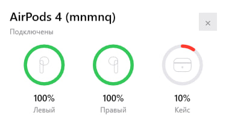
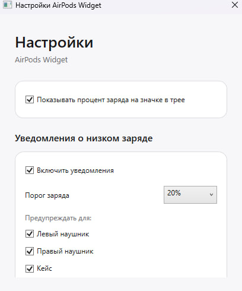

<div align="center">

<p align="center"><strong>English</strong> | <a href="README_RU.md">Русский</a></p>


# 🎧 AirPods Widget for Windows

**A lightweight Windows tray widget that brings an iOS-style AirPods battery experience to your PC.**

Battery levels for the left and right earbuds and charging case • Tray percentage • Low-battery alerts • Light & dark themes


</div>

---

## ✨ Overview

AirPods Widget is a small Windows application that lives in the system tray and displays the battery status of compatible AirPods. When the headphones connect, the widget can show an iOS-inspired battery card with separate indicators for the earbuds and charging case.

The application is designed to stay out of the way: click the tray icon whenever you want to check the battery level, configure low-battery warnings, or disable the percentage overlay.

## 📸 Screenshots

> Add the three screenshots from the repository to `assets/` using the names below.

| Battery widget | Settings |
|---|---|
|  |  |

## 🚀 Features

- 🎧 **Separate battery indicators** for the left and right AirPod.
- 🔋 **Charging-case battery level** when case data is available in the Bluetooth LE advertisement.
- 🟢 **iOS-style circular battery indicators**, with a low-charge state highlighted in red.
- 📊 **Battery percentage on the tray icon**, which can be disabled in Settings.
- 🔔 **Configurable low-battery notifications**.
  - Select the warning threshold from **10% to 100%**.
  - Enable warnings separately for the **left earbud**, **right earbud**, and **case**.
- 🌓 **Light and dark Windows theme support**.
- ⚡ **Charging-state indication**.
- 🖱️ **Quick access from the system tray**.
- 🚀 Optional **Start with Windows** mode.
- 🎧 Support for multiple AirPods generations, including AirPods Pro and AirPods Max identifiers handled by the battery monitor.
- 📦 Can be published as a normal .NET application or as a **self-contained executable**.

## 🖥️ Requirements

- Windows 10 version 2004 / build 19041 or newer, or Windows 11.
- Bluetooth adapter with Bluetooth Low Energy support.
- AirPods paired with Windows.
- .NET 8 SDK is required only when building from source.

## 📥 Build from source

Clone or download the repository, then run:

```bat
build.bat
```

The compiled application will be placed in:

```text
publish\AirPodsWidget.exe
```

The standard build targets **Windows x64** and uses the installed .NET runtime.

### Self-contained build

To create an executable that does not require the .NET Desktop Runtime to be installed separately, run:

```bat
build-self-contained.bat
```

The result will be placed in:

```text
publish-self-contained\AirPodsWidget.exe
```

### Clean build files

```bat
clean.bat
```

## ⚙️ Settings

Right-click the AirPods Widget tray icon and select **Настройки / Settings**.

### Tray percentage

Enable or disable the battery percentage displayed directly on the tray icon. For standard AirPods, the tray value represents the lower available earbud battery level.

### Low-battery notifications

Notifications can be enabled globally and configured with a threshold between **10% and 100%**. Alerts can be switched on or off independently for:

- Left earbud
- Right earbud
- Charging case

Settings are stored for the current Windows user.

## 🔋 About charging-case battery data

AirPods expose their battery information through Bluetooth LE advertisements. The charging case does not broadcast usable battery data continuously.

If the case battery is not visible:

1. Keep the AirPods close to the PC.
2. Put the earbuds in the charging case.
3. Open the case lid.
4. Wait for a new Bluetooth LE advertisement.

Once the application receives a valid case value, it keeps the latest known case level instead of immediately hiding it when a subsequent packet does not contain case information.

> **Note:** reported battery levels may be quantized. The application cannot create precision that is not present in the Bluetooth advertisement.

## 🧩 Project structure

```text
AirPodsWidget/
├── AirPodsBatteryMonitor.cs       # Bluetooth LE battery parser
├── AirPodsConnectionWatcher.cs    # Connection/disconnection watcher
├── App.xaml
├── App.xaml.cs                    # Application orchestration
├── AppSettings.cs                 # Persistent application settings
├── AutoStart.cs                   # Start with Windows
├── BatteryItem.cs                 # Circular battery UI
├── LowBatteryNotifier.cs          # Low-battery notification logic
├── PopupWindow.xaml
├── PopupWindow.xaml.cs            # Battery popup
├── SettingsWindow.cs              # Settings UI
├── Theme.cs                       # Light/dark palette
├── TrayIcon.cs                    # System tray icon and menu
├── AirPodsWidget.csproj
├── app.manifest
├── build.bat
├── build-self-contained.bat
└── clean.bat
```

## 🛠️ Technology

- **C# / .NET 8**
- **WPF** for the widget and settings interface
- **Windows Forms NotifyIcon** for system-tray integration
- **Windows.Devices.Bluetooth** APIs for Bluetooth device state and BLE advertisements
- Windows Registry under the current user for application preferences / autostart

## ❓ Troubleshooting

### AirPods are connected but no battery data appears

Battery data is received from Bluetooth LE advertisements and may arrive a little later than the Windows connection event. Open the AirPods case or reconnect the headphones and wait for the next update.

### The case is missing

Open the charging case near the computer. Case battery information is not guaranteed to be present in every BLE advertisement.

### AirPods have a custom name

Connection detection currently uses configured headphone-name keywords. If your renamed device is not detected, add the relevant name keyword to `AirPodsConnectionWatcher.NameKeywords`.

### Windows SmartScreen appears

Locally built or unsigned executables can trigger SmartScreen reputation warnings. For public releases, code-sign the executable with an appropriate Windows code-signing certificate.

## 🤝 Contributing

Bug reports and pull requests are welcome. When reporting a battery parsing issue, please include:

- AirPods model/generation
- Windows version
- Bluetooth adapter if known
- Whether earbud values are correct
- Whether the case value appears after opening the lid

Do not publish Bluetooth identifiers or other device-specific information that you consider private.

## 📄 License

This README assumes an **MIT License**. Add a `LICENSE` file to the repository if you intend to release the project under MIT, or replace the badge and this section with your chosen license.

---

<div align="center">

**AirPods Widget** • Simple AirPods battery monitoring for Windows

</div>
