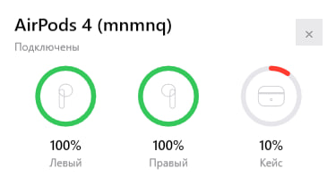
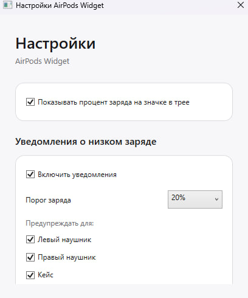

# 🎧 AirPods Widget для Windows

<p align="center"><a href="README.md">English</a> | <strong>Русский</strong></p>


**Лёгкий виджет для системного трея Windows, который показывает заряд AirPods в стиле iOS.**

Заряд левого и правого наушника и кейса • Процент в трее • Уведомления о низком заряде • Светлая и тёмная темы


---

## ✨ О проекте

AirPods Widget — небольшое приложение для Windows, которое работает в системном трее и показывает состояние аккумуляторов совместимых AirPods. При подключении наушников виджет может отображать карточку в стиле iOS с отдельными индикаторами для левого и правого наушника и зарядного кейса.

Приложение не мешает работе: нажмите на значок в трее, когда хотите проверить заряд, настроить предупреждения о низком заряде или отключить отображение процентов на значке.

## 📸 Скриншоты

| Виджет заряда | Настройки |
|---|---|
|  |  |

## 🚀 Возможности

- 🎧 **Отдельные индикаторы заряда** левого и правого наушника.
- 🔋 **Уровень заряда кейса**, когда эти данные присутствуют в Bluetooth LE-пакете.
- 🟢 **Круговые индикаторы в стиле iOS**, с красным цветом при низком заряде.
- 📊 **Процент заряда на значке в трее**, который можно отключить в настройках.
- 🔔 **Гибкие уведомления о низком заряде**.
  - Порог предупреждения от **10% до 100%**.
  - Отдельное включение уведомлений для **левого наушника**, **правого наушника** и **кейса**.
- 🌓 Поддержка **светлой и тёмной темы Windows**.
- ⚡ Индикация **процесса зарядки**.
- 🖱️ Быстрый доступ из системного трея.
- 🚀 Опциональный **автозапуск вместе с Windows**.
- 🎧 Поддержка нескольких поколений AirPods, включая идентификаторы AirPods Pro и AirPods Max, распознаваемые монитором заряда.
- 📦 Возможность обычной публикации .NET-приложения или создания **автономного self-contained EXE**.

## 🖥️ Требования

- Windows 10 версии 2004 / сборки 19041 или новее либо Windows 11.
- Bluetooth-адаптер с поддержкой Bluetooth Low Energy.
- AirPods должны быть сопряжены с Windows.
- .NET 8 SDK требуется только для сборки из исходного кода.

## 📥 Сборка из исходного кода

Склонируйте или скачайте репозиторий, затем запустите:

```bat
build.bat
```

Готовое приложение появится в:

```text
publish\AirPodsWidget.exe
```

Стандартная сборка рассчитана на **Windows x64** и использует установленный .NET Runtime.

### Автономная сборка

Чтобы создать EXE, которому не требуется отдельно установленный .NET Desktop Runtime, запустите:

```bat
build-self-contained.bat
```

Результат будет находиться в:

```text
publish-self-contained\AirPodsWidget.exe
```

### Очистка файлов сборки

```bat
clean.bat
```

## ⚙️ Настройки

Нажмите правой кнопкой мыши по значку AirPods Widget в системном трее и выберите **Настройки / Settings**.

### Процент заряда в трее

Можно включить или отключить отображение процента заряда непосредственно на значке в трее. Для обычных AirPods используется меньшее из доступных значений заряда двух наушников.

### Уведомления о низком заряде

Уведомления можно включить глобально и установить порог от **10% до 100%**. Предупреждения включаются и отключаются независимо для:

- левого наушника;
- правого наушника;
- зарядного кейса.

Настройки сохраняются для текущего пользователя Windows.

## 🔋 О данных заряда кейса

AirPods передают информацию о заряде через рекламные пакеты Bluetooth LE. Зарядный кейс не передаёт пригодные для чтения данные постоянно.

Если заряд кейса не отображается:

1. Поднесите AirPods ближе к компьютеру.
2. Положите наушники в зарядный кейс.
3. Откройте крышку кейса.
4. Дождитесь нового Bluetooth LE-пакета.

После получения корректного значения приложение сохраняет последний известный заряд кейса и не скрывает его сразу, если в следующем пакете эти данные отсутствуют.

> **Примечание:** значения заряда могут передаваться с определённым шагом. Приложение не может показать точность, которой нет в исходных Bluetooth-данных.

## 🧩 Структура проекта

```text
AirPodsWidget/
├── AirPodsBatteryMonitor.cs       # Разбор данных заряда Bluetooth LE
├── AirPodsConnectionWatcher.cs    # Отслеживание подключения и отключения
├── App.xaml
├── App.xaml.cs                    # Основная логика приложения
├── AppSettings.cs                 # Сохраняемые настройки
├── AutoStart.cs                   # Автозапуск с Windows
├── BatteryItem.cs                 # Круговой индикатор заряда
├── LowBatteryNotifier.cs          # Уведомления о низком заряде
├── PopupWindow.xaml
├── PopupWindow.xaml.cs            # Всплывающая карточка заряда
├── SettingsWindow.cs              # Окно настроек
├── Theme.cs                       # Светлая/тёмная палитра
├── TrayIcon.cs                    # Значок и меню системного трея
├── AirPodsWidget.csproj
├── app.manifest
├── build.bat
├── build-self-contained.bat
└── clean.bat
```

## 🛠️ Технологии

- **C# / .NET 8**
- **WPF** для интерфейса виджета и настроек
- **Windows Forms NotifyIcon** для интеграции с системным треем
- API **Windows.Devices.Bluetooth** для состояния Bluetooth-устройств и BLE-пакетов
- Реестр Windows текущего пользователя для настроек приложения и автозапуска

## ❓ Решение проблем

### AirPods подключены, но данные о заряде не появляются

Данные о заряде поступают через Bluetooth LE и могут появиться немного позже события подключения Windows. Откройте кейс AirPods либо переподключите наушники и дождитесь следующего обновления.

### Не отображается кейс

Откройте зарядный кейс рядом с компьютером. Информация о заряде кейса присутствует не в каждом BLE-пакете.

### У AirPods другое имя

Определение подключения использует настроенные ключевые слова в имени наушников. Если переименованное устройство не определяется, добавьте нужное ключевое слово в `AirPodsConnectionWatcher.NameKeywords`.

### Появляется предупреждение Windows SmartScreen

Локально собранные или неподписанные EXE-файлы могут вызывать предупреждение SmartScreen. Для публичных релизов рекомендуется подписывать приложение подходящим сертификатом подписи кода Windows.

## 🤝 Участие в разработке

Сообщения об ошибках и pull request приветствуются. При сообщении о проблемах с определением заряда желательно указать:

- модель/поколение AirPods;
- версию Windows;
- модель Bluetooth-адаптера, если известна;
- корректно ли отображается заряд наушников;
- появляется ли заряд кейса после открытия крышки.

Не публикуйте Bluetooth-идентификаторы и другие сведения об устройстве, которые считаете конфиденциальными.

## 📄 Лицензия

Этот README предполагает использование **лицензии MIT**. Если проект действительно будет распространяться по MIT, добавьте файл `LICENSE`. В противном случае замените badge и этот раздел на выбранную лицензию.

---

**AirPods Widget** • Простой мониторинг заряда AirPods в Windows
